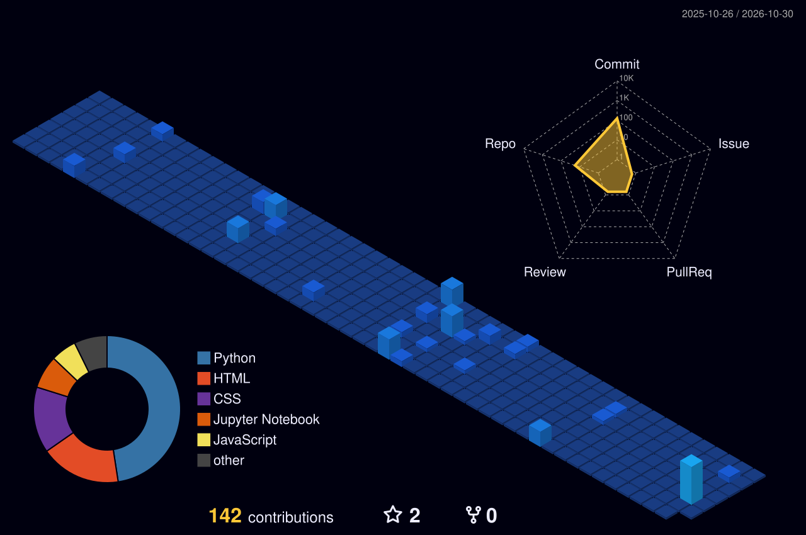

<!-- ============ HEADER BANNER (animated wave) ============ -->
<p align="center">
  
</p>

<p align="center">
  <a href="https://github.com/ankit9508220322">
    
  </a>
</p>

<p align="center">
  
  <a href="https://github.com/ankit9508220322?tab=followers"></a>
  <a href="https://github.com/ankit9508220322?tab=repositories"></a>
</p>

<p align="center">
  <a href="https://ankit9508220322.github.io/Shope_meanu/"></a>
  <a href="https://github.com/ankit9508220322"></a>
  <a href="https://www.facebook.com/choubey.ji.731"></a>
</p>

---

## 👨‍💻 About Me

```python
class AnkitKumarChoubey:
    def __init__(self):
        self.role      = "Aspiring Data Analyst"
        self.education = "BCA Student"
        self.location  = "Rohtas, Bihar, India 🇮🇳"
        self.skills    = ["Python", "SQL", "Power BI", "Excel", "Data Visualization"]
        self.learning  = ["Advanced SQL", "Power BI", "Machine Learning"]
        self.goal      = "Start my career as a Data Analyst 🎯"

    def say_hi(self):
        print("Thanks for visiting my profile! ⭐")

Ankit = AnkitKumarChoubey()
Ankit.say_hi()
```

---

## 🧊 My 3D Contribution Graph

<p align="center">
  <picture>
    <source media="(prefers-color-scheme: dark)" srcset="./profile-3d-contrib/profile-night-view.svg">
    <source media="(prefers-color-scheme: light)" srcset="./profile-3d-contrib/profile-green-animate.svg">
    
  </picture>
</p>

## 🐍 Contribution Snake

<p align="center">
  <picture>
    <source media="(prefers-color-scheme: dark)" srcset="https://raw.githubusercontent.com/ankit9508220322/ankit9508220322/output/github-snake-dark.svg">
    <source media="(prefers-color-scheme: light)" srcset="https://raw.githubusercontent.com/ankit9508220322/ankit9508220322/output/github-snake.svg">
    
  </picture>
</p>

---

## 🛠️ Tech Stack

<details open>
<summary><b>🐍 Programming & Data Analytics</b></summary>
<br>


</details>

<details open>
<summary><b>📊 Data Visualization</b></summary>
<br>


</details>

<details open>
<summary><b>🗄️ Database</b></summary>
<br>


</details>

<details open>
<summary><b>📑 Office & Productivity</b></summary>
<br>


</details>

<details open>
<summary><b>🌐 Web & Apps</b></summary>
<br>


</details>

---

## 🚀 Featured Projects <sub>(click any card to open the repo)</sub>

<p align="center">
  <a href="https://github.com/ankit9508220322/quiz_project"></a>
  <a href="https://github.com/ankit9508220322/Calculator_website"></a>
</p>
<p align="center">
  <a href="https://github.com/ankit9508220322/MusicPlayer-"></a>
  <a href="https://github.com/ankit9508220322/make-you-stopwatch-new-projects-"></a>
</p>
<p align="center">
  <a href="https://github.com/ankit9508220322/Pythone_Programe"></a>
  <a href="https://github.com/ankit9508220322/Age_calculate_project"></a>
</p>

<details>
<summary><b>📂 More projects & ideas I've built / am building</b></summary>
<br>

| Project | Type |
|---|---|
| 📊 Data Analytics Projects | Python · Pandas · Visualization |
| 📈 Startup Data Analysis | EDA · Insights |
| 🏏 IPL Data Analysis | EDA · Plotly |
| 🌦️ Weather Application | Web / API |
| 🎵 Music Player | HTML · CSS · JS |
| 🧮 Calculator | HTML · CSS · JS |
| 📝 Quiz Application | JavaScript |
| 🔐 Random Password Generator | Python |
| 🌐 Portfolio Website | HTML · CSS |

</details>

---

## 📊 GitHub Stats

<p align="center">
  
  
</p>
<p align="center"></p>
<p align="center"></p>

---

## 📚 Currently Learning

<p align="center">
  
  
  
  
  
</p>

## 🎯 Career Goal

> To start my career as a **Data Analyst** and use **Python, SQL, Power BI** and other analytics tools to turn raw data into meaningful insights.

---

## 📫 Let's Connect

<p align="center">
  <a href="https://github.com/ankit9508220322"></a>
  <a href="https://ankit9508220322.github.io/Shope_meanu/"></a>
  <a href="https://www.facebook.com/choubey.ji.731"></a>
</p>

<p align="center">
  
</p>
